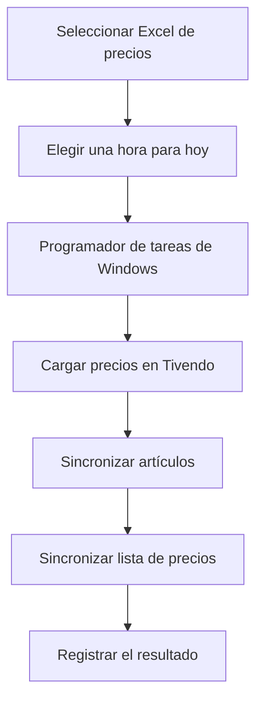

# Programación y sincronización de precios

**Preparar los precios ahora y dejar su procesamiento programado para la hora elegida.**

Herramienta en Python para coordinar operaciones web entre Tivendo y una plataforma de comercio: carga de precios, sincronización de artículos, listas de precios y packs.

## El problema que resuelve

Estas operaciones requerían entrar a los sistemas, descargar información y volver a cargar archivos manualmente. Además, en el flujo utilizado por el equipo no se disponía de la programación de precios que se necesitaba.

La herramienta reúne esas tareas en un menú y permite elegir un Excel de precios y una hora de ejecución. Así, el trabajo se puede preparar con anticipación y el ciclo se ejecuta mediante una tarea de Windows.

## Flujo programado



## Funciones

- Carga de un archivo Excel de precios en Tivendo.
- Exportación de artículos y listas de precios, y carga en la plataforma de destino.
- Operaciones de exportación y sincronización de packs.
- Ejecución de tareas individuales o del ciclo completo desde un menú.
- Programación de una ejecución **única para una hora futura del mismo día**.
- Selección del archivo que se procesará en la ejecución programada.
- Registros de progreso, reintentos y comprobaciones del resultado de importación.
- Apagado opcional del equipo al terminar, únicamente si se solicitó y el ciclo finalizó sin errores.

## Tecnologías y estructura

Python, asyncio y Playwright para controlar el navegador; Programador de tareas de Windows para ejecutar el ciclo a la hora seleccionada.

| Componente | Responsabilidad |
| --- | --- |
| [`menu.py`](menu.py) | Menú, coordinación de tareas y programación horaria. |
| [`upload_precios.py`](upload_precios.py) | Carga de precios y lectura del resultado de importación. |
| [`sync_articulos.py`](sync_articulos.py) | Sincronización de artículos. |
| [`sync_precios.py`](sync_precios.py) | Sincronización de listas de precios. |
| [`sync_packs.py`](sync_packs.py) | Operaciones con packs. |
| [`tests/`](tests/) | Pruebas de configuración, menú y funciones de los flujos. |

## Preparar el entorno

La automatización está orientada a Windows. El instalador incluido utiliza Python 3.12; para un entorno de desarrollo aislado:

```powershell
python -m venv .venv
.\.venv\Scripts\python.exe -m pip install playwright
.\.venv\Scripts\python.exe -m playwright install chromium
```

**Dependencia local pendiente en una instalación desde cero:** el repositorio excluye `credenciales.py` mediante `.gitignore`, pero los flujos y varias pruebas lo importan. Para ejecutar el proyecto se necesita incorporar localmente un módulo compatible con los accesos y las funciones de configuración esperadas por el código, incluida `guardar_credenciales`.

Los accesos utilizados por los flujos son `TIVENDO_EMAIL`, `TIVENDO_PASSWORD`, `MH_EMAIL` y `MH_PASSWORD`. Las pruebas de configuración también utilizan `cargar_credenciales`, `CRED_FILE` y `DEFAULTS`. Los valores reales se mantienen fuera del repositorio. Una clonación por sí sola no completa esa dependencia local.

Una vez configurado el módulo y el entorno autorizado:

```powershell
.\.venv\Scripts\python.exe menu.py
```

También se incluyen `1_INSTALAR.bat` e `INICIAR.bat` para el flujo de instalación y arranque original en Windows. El instalador puede instalar herramientas en el equipo; conviene revisar sus rutas antes de usarlo en otro entorno.

## Programar una ejecución

1. Abrir el menú y revisar los accesos y la sucursal configurada.
2. Elegir **Programar ejecución para hoy**.
3. Indicar una hora futura del mismo día y seleccionar el Excel de precios.
4. Elegir si se desea apagar el equipo después de una ejecución correcta.
5. Revisar la confirmación. El equipo debe permanecer encendido y con acceso a los sistemas a la hora programada.

El menú genera la tarea de Windows y el archivo de arranque correspondiente. La programación puede requerir permisos elevados. El archivo `ejecutar_automatico.bat` versionado conserva rutas del entorno original; la opción del menú lo regenera para el entorno en uso.

## Pruebas existentes

Con las dependencias y el módulo local de configuración disponibles:

```powershell
.\.venv\Scripts\python.exe -m unittest discover -s tests -v
```

La carpeta `tests/` contiene pruebas de configuración, credenciales, menú, packs, lectura de importaciones y utilidades. La suite completa no puede ejecutarse desde una clonación que carezca de `credenciales.py`.

## Alcance operativo

La programación publicada es de una sola ejecución para el día actual. Los flujos dependen de las interfaces web de los sistemas y de una configuración válida. Las cargas modifican precios o información en los sistemas de destino; su validación requiere un entorno autorizado y archivos preparados para esa operación.

---

Proyecto del catálogo de [Sebastian Araya — Sistemas, Logística y Automatización](https://github.com/FoorKeM).
